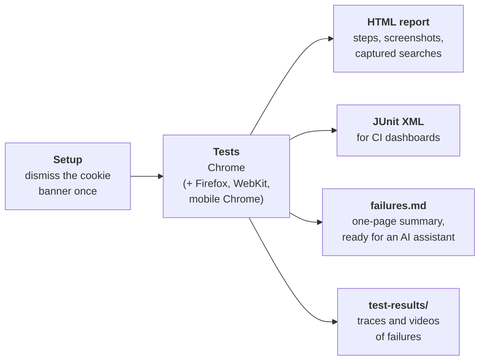
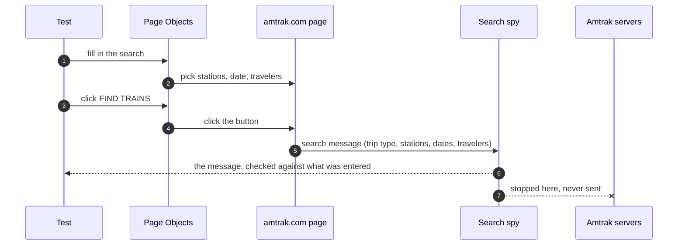
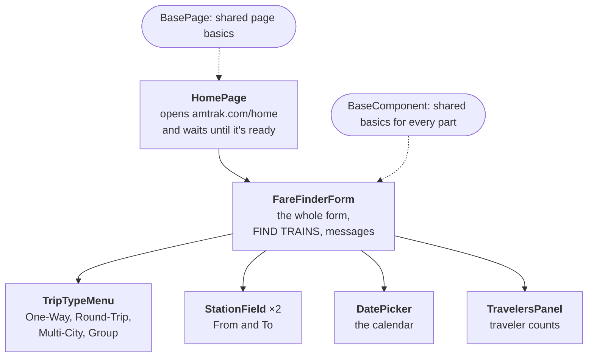
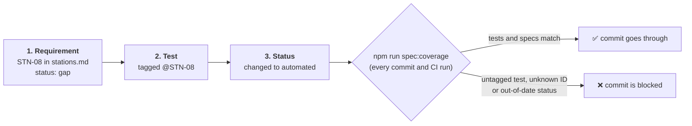

# Amtrak "Find trains" – automated test suite

Automated tests (Playwright + TypeScript, built with the **Page Object pattern**) for the **"Find trains" search form on [amtrak.com/home](https://www.amtrak.com/home)**. They cover everything from filling in the form **up to clicking FIND TRAINS**, plus the results page, fed a saved real reply from Amtrak; booking isn't tested.

**Status (run against the live site):** all 70 tests pass in Chrome. A smaller set of key tests also passes in Firefox, Safari's engine (WebKit) and mobile Chrome. Run logs and screenshots: [`docs/evidence/`](docs/evidence/README.md).

## What's in this suite

| Kind of testing | What it covers | Where |
|---|---|---|
| **Functional** | Filling in the form and checking the search FIND TRAINS sends: stations, dates, travelers, trip types, paying with points | `submission`, `stations`, `dates`, `travelers`, `trip-type` tests |
| **Validation** | 24 tests that the form refuses bad input (missing fields, the same station twice, past dates, too many travelers, invalid coupon characters) and that nothing is sent | tests marked `@negative` |
| **Edge cases** | Leaving today, the 11-month booking limit, trips across month-end and New Year, several traveler combinations, typing a date instead of picking it | `dates`, `submission` tests |
| **Accessibility** | Automated WCAG checks of the form, station suggestions, calendar and travelers panel. Known problems are recorded; any new one fails the test | `accessibility.spec.ts` |
| **Visual** | The travelers panel is compared with an approved screenshot (with separate approved images for Mac and Linux, which draw fonts differently) | `visual.spec.ts` |
| **Mobile and other browsers** | The 15 key search tests also run in Firefox, Safari's engine (WebKit) and mobile Chrome on a phone-sized screen. Mobile differences are handled: dates can only be picked from the calendar, and buttons are tapped like a finger | `npm run test:cross-browser`, or "all browsers" on GitHub |
| **Amtrak's station data** | The replies the page gets from Amtrak's station services: the station list contains the stations the tests rely on, with the right names, and the station-search reply matches what the dropdown shows. Read from the page's own traffic, with no extra requests | `stations.spec.ts` |
| **Server problems (simulated)** | What users see when Amtrak's station search is slow (a "Loading" message) or failing (a built-in station list), and when the train search fails (an error message, with their search kept) or succeeds (the results page, from a saved real reply) | `stations.spec.ts` (`@mocked`), `submission.spec.ts` |
| **Known bugs** | A test that reproduces Amtrak's Swap bug (F-01). It fails until Amtrak fixes it, so it runs only on demand | `npm run test:known-bugs` |

Around the tests:
- **Requirements:** 62 numbered requirements in scope, each linked to its tests, with an automatic check that the two stay in sync (see [Requirements first](#approach)).
- **Code checks on every commit:** lint (which also blocks fixed waits and missing `await`s), formatting and type checking.
- **Runs on GitHub, started by hand** (Actions → "E2E - Find trains" → Run workflow): all tests in Chrome, or all browsers. They deliberately don't run on every push or on a schedule, to keep automated traffic to amtrak.com to a minimum. When a test fails, the run's summary page shows a one-page report: the error, the steps leading to it, and what the page looked like. It's ready to paste into an AI assistant.
- **Bug reports for Amtrak:** [`docs/findings.md`](docs/findings.md).
- **Support for AI coding assistants:** instructions in [`.claude/CLAUDE.md`](.claude/CLAUDE.md), plus a step-by-step guide for writing new tests.

## Quick start

Requires **Node.js 20.12+** and an internet connection (the tests run against the live site).

```bash
npm ci                            # install the exact dependency versions from package-lock.json
npx playwright install chromium   # download the browser the tests use
npm test                          # run all tests in Chrome (no browser window opens)
```

| Also useful | |
|---|---|
| `npm run test:headed` | Watch the browser while tests run |
| `npx playwright test --grep @STN-08` | Run only the tests for one requirement (here STN-08) |
| `npm run report` | Open the HTML report of the last run |
| `npm run spec:coverage` | Show which requirements are tested, and the open gaps |

What a run produces:



Nothing else needs setting up: every setting has a default.

**Settings (optional).** To change one, such as the environment or time zone, set it in the shell for one run, or copy `.env.example` to `.env` to keep it:

```bash
TEST_ENV=qa QA_BASE_URL=https://qa.example.com npm test   # this run only
cp .env.example .env                                       # or keep settings in .env (not committed)
```

The `.env` file is read when Playwright loads its config (`src/utils/env.ts`), before any setting is used. A value set in the shell wins over the file.

**Environments.** `TEST_ENV` (default `production`) picks a profile in `src/environments/` with that environment's address, the tests that don't apply there, and only the test data that differs from production. Tests don't change: `Stations.NEW_YORK` simply resolves to the right values.

Every setting and command, and how the automated runs on GitHub work, are in **[`docs/FRAMEWORK.md`](docs/FRAMEWORK.md)**.

## Approach

**How a test knows the search worked.** The scope ends at the FIND TRAINS click, so the tests don't open the results page. Instead, they check what the click sends. When you press FIND TRAINS, the page sends Amtrak's server one message describing the search: the trip type, the stations, the dates and who is travelling. Each test catches that message and checks it matches what the test entered in the form. Then it stops the message before it leaves the browser.

This proves the form built the right search without relying on the results page. It also means no automated searches reach Amtrak, whose servers reject them anyway.



**What about the results page?** Amtrak's bot protection blocks every automated search, even from a real Chrome browser driven by a tool, so a test can't get real results from Amtrak. Instead, the spy can answer the search itself:

- **With real results (SUB-10).** We ran one search by hand in a normal browser and saved Amtrak's reply ([`src/data/search-replies/`](src/data/search-replies/), trimmed to 3 trains). The test gives that reply to the page, with its dates moved to the test's date, and checks the page moves on to the results and lists those trains with their times and prices.
- **With an error (SUB-09).** The test checks the user sees a clear message and keeps what they typed.

Either way, the search never reaches Amtrak.

**Page Objects.** Tests never touch the web page directly. Every part of the page is represented by a class that knows how to find its elements and how to use them, and the tests only call those classes:



The page classes live in `src/pages/`, the form parts in `src/components/`.

So a test reads like the steps a person would take. This is the real test for "the same station twice is refused":

```ts
const form = homePage.fareFinder;

await form.from.selectByCode(Stations.NEW_YORK);
await form.to.selectByCode(Stations.NEW_YORK);

await expect(form.message(Messages.SAME_STATIONS)).toBeVisible();
await form.expectSearchDisabled();
await form.clickFindTrains();
await searchSpy.expectNoSearch();
```

Why it's built this way:
- **One place to fix.** When Amtrak changes the page, only the class for that part needs updating, not every test that uses it.
- **Reusable parts.** The form is split into small parts (`StationField`, `DatePicker`…), and the same station search and calendar appear elsewhere on amtrak.com, e.g. the Schedules page. A new page can reuse them instead of starting over.
- **Shared basics in one place.** `BasePage` and `BaseComponent` hold what every page and part needs, such as waiting for the page to be ready and always picking the visible copy of an element.

**How the rest of the code is organised**
- **Test data with sensible defaults.** A small helper builds a valid search: New York → Washington, two weeks from today, one adult. Each test changes only what it's about, for example `aSearch().roundTrip(3).from(Stations.BOSTON)`. Dates are always relative to today, so tests never go out of date (the Builder pattern).
- **Ready-made setup.** Every test starts with the page already open and ready, so its body contains only the steps that matter (Playwright fixtures).
- **Reliable element lookup.** Elements are found by the test IDs Amtrak put in its own page, or by their accessible names, the labels a screen reader would use. Amtrak draws the form twice, a desktop and a mobile version with one of them hidden, so lookups always pick the visible one.

**Keeping tests stable on a live website**
- A test starts only after the page has loaded its list of stations, not just when the form appears.
- The cookie banner is dismissed once, before all tests, so it can't pop up in the middle of one.
- Tests never "wait two seconds and hope"; they wait for something specific to happen. The three places where a fixed pause is unavoidable are named and explained in `playwright.config.ts`, and a lint rule blocks any new ones.

**Requirements first.** Every behaviour the form should have is written down as a numbered requirement in [`specs/find-trains/`](specs/README.md). For example, STN-08 is "the same station for From and To is rejected". Every test is labelled with the requirement it checks. An automatic check (`npm run spec:coverage`, run on every commit and in CI) fails if a test isn't linked to a requirement, or if the record of what's tested falls out of date.



## What is tested and why

The form has two jobs: turn what the user enters into a correct search, and refuse anything that can't be searched. The tests cover both, plus the unusual cases most likely to break. Each area has a requirements file and a test file with the same name, e.g. `specs/find-trains/stations.md` and `tests/find-trains/stations.spec.ts`.

| Area | What should work | What should be refused |
|---|---|---|
| [Submitting a search](specs/find-trains/submission.md) | One-way and round trips, every traveler type, leaving today, swapped stations, several traveler combinations, paying with points. Each test checks the exact search that's sent | If the search server fails, an error is shown and the user's search is kept |
| [Stations](specs/find-trains/stations.md) | Suggestions while typing, typing a station code (e.g. BOS), lowercase codes, keyboard-only use, the Swap button. With a simulated slow server, a "Loading" message shows. Amtrak's station list and search replies match what the form shows | Unknown stations, code-like input such as ``, the same station for From and To. With a simulated server failure, a built-in station list is offered instead |
| [Dates](specs/find-trains/dates.md) | Today, dates months ahead, return dates, same-day return, the 11-month booking limit, typing a date, trips across month-end and New Year | Past dates, returning before departing, closing the calendar without a date, typed dates that are impossible, past or too far ahead |
| [Travelers](specs/find-trains/travelers.md) | One adult by default, the total shown, Reset, up to 8 travelers, the "Traveling Alone?" policy | 9 or more travelers, no adult, children alone, counts below zero |
| [Trip type](specs/find-trains/trip-type.md) | One-way by default, switching round-trip back to one-way, Multi-City trips, the Group Travel page | – |
| [Required fields](specs/find-trains/required-fields.md) | Ticking "assistance needed" asks for those details before searching | Searching with something missing (each case also checks that no search is sent) |
| [Coupons](specs/find-trains/coupons.md) | – | Coupon codes accept only letters and digits, up to 14 |
| [Accessibility](specs/find-trains/accessibility.md), [Visual](specs/find-trains/visual.md) | The travelers panel still looks like its approved screenshot | No new accessibility problems (WCAG) in the form, suggestions, calendar or travelers panel |

**Coverage:** 61 of the 62 requirements in scope have tests. One of those tests reproduces a known Amtrak bug (see F-01 below). One requirement is an open gap: CPN-02 (feedback for an invalid coupon), which needs a real coupon to pin down what "invalid" means. Things deliberately not tested are listed with reasons in the requirement files.

## Testing ethically

These tests run against a live website we don't own, and Amtrak's [terms of use](https://www.amtrak.com/planning-booking/policies/web-notices-terms-of-use) restrict automated access. We aimed to stay within the spirit of those terms:
- the tests use the form like a visitor would, and scrape nothing;
- they never try to get past Amtrak's bot protection, and stop when it blocks them;
- every search request is stopped in the browser, so nothing reaches Amtrak's booking systems;
- runs happen only when someone starts them;
- findings are written as constructive bug reports. Any security issue would have been reported to Amtrak privately, not published here.

## Findings on amtrak.com

Writing the tests surfaced real issues, found through normal use of the form (see [Testing ethically](#testing-ethically)). Full bug reports, with steps and evidence, are in **[`docs/findings.md`](docs/findings.md)**.

| # | Finding | Severity |
|---|---|---|
| F-01 | Clicking Swap quickly shows the same station in both fields, while a different route is searched | Medium |
| F-02 | Right after a station is picked, the cursor jumps back to it, so a date typed next ends up in the station field ("WAS/2026") | Medium |
| F-03 | Travelers panel: the five number boxes have no labels, so screen readers can't tell them apart | High (accessibility) |
| F-04 | Booking form: 5 kinds of accessibility problems (2 critical) before the user does anything | High (accessibility) |
| F-05 – F-09 | Smaller issues: adult age shown as 16+ but required as 18, a misleading date-format hint, invalid input rejected without a message, odd station order when the server fails, Enter starting a location lookup | Low |

## Assumptions

- **The tests run against the real amtrak.com.** No test environment was available, so the tests only read and never complete a booking or search.
- **The search the page sends is the result we check.** Amtrak's servers block automated searches (an error banner appears on the page), which is expected and doesn't affect the tests.
- **Browsers:** every test runs in Chrome on a desktop-sized screen. A smaller set of key tests also runs in Firefox, Safari's engine (WebKit) and mobile Chrome.
- **Station data stays the same:** e.g. NYP is New York Penn Station.
- **"Today" is New York time**, for both the browser and the tests.
- **Cookies:** the banner is dismissed with "Reject All", as a privacy-minded user would.

## With more time

- **A test environment and test accounts**, to run live searches through to the results page (today the results come from one saved reply), use points with a real balance, and try a real coupon (gap CPN-02).
- **API tests for the train search**, once Amtrak gives the test runner access (a test environment, credentials or an allow-listed address). They would be faster and more precise than browser tests, but the search API is behind bot protection that must not be bypassed.
- **A formal description of the search message**, so that if Amtrak changes its format, the failure says exactly what changed.
- **Close the last gap**, CPN-02, once a real coupon is available.
- **More saved replies** (round trip, sold-out trains, no trains found) to check more of the results page the same way.
- **Page-speed checks** on the home page, tracked over time.
- **Faster runs as the suite grows:** split tests across machines, and run only the tests affected by a change.
- **Send the findings** to Amtrak (the reports in [`docs/findings.md`](docs/findings.md) are ready).

---

More detail: [`docs/FRAMEWORK.md`](docs/FRAMEWORK.md) (all commands, automated runs on GitHub, debugging failures, folder layout) · [`.claude/CLAUDE.md`](.claude/CLAUDE.md) (instructions for AI coding assistants; `AGENTS.md` points to the same file)
